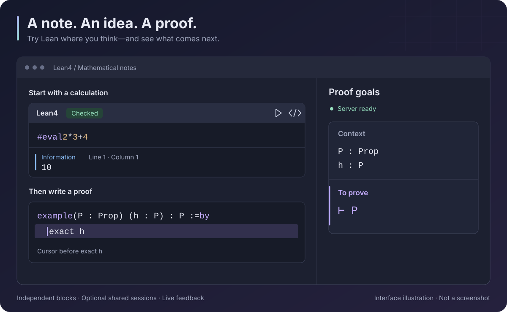

<div align="center">
  
  <h1>Lean4</h1>
  <p><strong>Write notes. Try Lean. See what remains to prove.</strong></p>
  <p>Lean 4 code blocks and proof goals, right inside Obsidian.</p>
  <p>English · <a href="README.zh-CN.md">简体中文</a></p>

[](https://github.com/ewigmidori/obsidian-lean4/actions/workflows/ci.yml)
[](LICENSE)
</div>



*Interface illustration, not a screenshot. Colors and layout follow your Obsidian theme.*

Use Lean4 for mathematical notes, small experiments, and proofs you want to explain as you write. **Each code block is independent by default.** When a proof spans several blocks, give them a shared session name.

You can start in an ordinary note: no separate Lean project is needed. The interface supports English and Simplified Chinese and follows Obsidian's language.

## 1. Install the plugin

You need **Obsidian desktop 1.8.0 or later**. The plugin is not yet listed in the community plugin directory.

When a published version is available, download `main.js`, `manifest.json`, and `styles.css` from [Releases](https://github.com/ewigmidori/obsidian-lean4/releases). Draft releases are visible only to repository collaborators. If no published version is listed, [build from source](#build-from-source).

1. Create this folder inside your vault: `.obsidian/plugins/lean/`.
2. Copy the three files into it:

   ```text
   <your vault>/.obsidian/plugins/lean/
     main.js
     manifest.json
     styles.css
   ```

3. Restart Obsidian, then open **Settings → Community plugins** and enable **Lean4**. Enable community plugins first if restricted mode is on.

## 2. Run your first block

Create a note and paste this Markdown:

````markdown
```lean
#eval 2 * 3 + 4
```
````

Place the cursor inside the block and run **Lean4: Check current block** from the command palette. In Live Preview or Reading view, you can also use the block's **▶** check icon.

If Lean needs to be installed, choose **Prepare Lean** in the panel that opens. Keep the default **Basic (managed automatically)** environment. It reuses a compatible installed toolchain when possible; downloading missing tools starts only when you choose to prepare them.

Once checking finishes, the message body shows **`10`**. The **Information** label identifies the message type; **Line 1 · Column 1** locates it in the block. This is normal output, not an error.

The basic environment includes **Lean 4.35.0 and Std**. You do not need to configure a project path for these examples.

## 3. See what remains to prove

Add a second block:

````markdown
```lean
example (P : Prop) (h : P) : P := by
  exact h
```
````

Open **Lean4: Show goals** from the command palette, or click **σ** in the left ribbon. In editing mode, place the cursor at the **start of `exact h`**, before the tactic runs.

The side panel shows:

```text
Context
P : Prop
h : P

To prove
⊢ P
```

`h : P` says you already have a proof of `P`. `⊢ P` says `P` is the current goal. The tactic `exact h` supplies that proof. Move the cursor to the end of the tactic to inspect the state after it; there should be no remaining goals.

Goals follow the cursor position. To investigate an error, click its line/column location in the side panel to return to the source. Lean's goal text and diagnostic messages remain in their original language.

## 4. Keep examples independent—or connect them

Two ordinary blocks can both define `answer` without a name collision. A definition in one block is **not visible** in another by default. This keeps unrelated examples safe to copy into the same note.

For a connected explanation, add the same `session` value to its blocks:

````markdown
```lean session=arithmetic title="A definition"
def base : Nat := 40
```

Explain the idea here, in ordinary Markdown.

```lean session=arithmetic title="A proof"
example : base + 2 = 42 := by
  rfl
```
````

Now the second block can use `base`. Checking either block checks the shared session; you do not need to click the blocks in order.

- Sharing is limited to the **same note**, with names matched exactly and case-sensitively.
- Blocks contribute code in their current note order. Editing or moving an earlier block changes the later context.
- Put any `import` statements at the top of the first participating block.
- Errors in an earlier block can affect later proofs. Different sessions remain separate.

## 5. Keep unfinished syntax examples in your notes

Use `check=off` when a block is only an illustration:

````markdown
```lean check=off title="A proof sketch"
example (P Q : Prop) : P → Q := by
  -- Explain the tactic syntax here.
```
````

The block is marked **Display only**. It is not checked and contributes no code to a shared session, even if it has a session name.

| Option | When to use it |
| --- | --- |
| `title="My example"` | Give a block a readable heading. |
| `session=arithmetic` | Share definitions with matching blocks in this note. |
| `check=off` | Show an incomplete sketch or an intentionally invalid example. |

Both `lean` and `lean4` fences work. Separate options with spaces; quote values containing spaces. Unknown or malformed options are reported and keep the block display-only until corrected.

## When you need more

**Mathlib or your own libraries.** In **Settings → Lean4 → Lean environment**, choose **Existing project (advanced)** and select a Lake project that already has your dependencies. Run `lake build` there first, then choose **Save and apply**. The project's `lean-toolchain` determines the Lean version. The basic environment does not include Mathlib.

**Faster symbol entry.** Inside a Lean block, type `\alpha`, `\forall`, or `\to`, then press **Tab** to insert `α`, `∀`, or `→`.

**Check a whole note.** Run **Lean4: Check all blocks in current note**. The plugin queues independent blocks and shared sessions with bounded concurrency. Performance settings are under the collapsed **Performance** section.

### If something does not work

| What you see | What to try |
| --- | --- |
| Lean is not ready | Choose **Prepare Lean**; expand **Details** for the original error if preparation fails. |
| No goals appear | Open **Show goals**, enter editing mode, and put the cursor inside a tactic—not on the code fence. A completed proof may have no goals. |
| A name from another block is unknown | Give the related blocks the same `session`, or keep the definition and proof together. |
| `lake` is not found in project mode | Set **Lake executable** to the absolute path of `lake` / `lake.exe`, without command-line arguments. |
| The service stops responding | Run **Lean4: Restart language server**, then check again. |

### Current scope

This is an early desktop release. It provides plain-text goals, diagnostics, basic syntax highlighting, and Unicode shortcuts. Completion, hover types, go-to-definition, and interactive Lean widgets are not implemented. Fences nested inside lists or blockquotes are not supported. One selected Lean environment serves the whole plugin.

Automated checks run on Windows and Linux. These do not replace desktop testing in Obsidian; see the [validation record (Chinese)](docs/validation.md) for what has actually been tested.

## Network access and external tools

Lean4 runs Lean and Lake as local external processes. Checking sends code to the local language server, not to a hosted proof service. The plugin has no telemetry and requires no paid service or account.

**Optional tool installation:** choosing **Prepare Lean** explicitly permits downloading and installing missing external tools. The plugin first looks for an installed Lean 4.35.0 toolchain. If elan is missing, it downloads elan v4.2.4 from the official leanprover/elan GitHub releases (including GitHub asset redirects), verifies the archive against a pinned SHA-256 digest, and installs it in its user cache. It then invokes elan to install leanprover/lean4:v4.35.0 from Lean's official distribution infrastructure. The pinned archive verification applies to the elan installer; the Lean download is managed by elan. Detection alone does not start these downloads.

**Files outside the vault:** the managed basic project and private tools are stored under %LOCALAPPDATA%/lean4-obsidian-plugin on Windows, ~/Library/Caches/lean4-obsidian-plugin on macOS, or $XDG_CACHE_HOME/lean4-obsidian-plugin (falling back to ~/.cache/lean4-obsidian-plugin) on Linux. Reusing an existing elan installs a missing toolchain in that manager's toolchain storage instead. The plugin does not modify the persistent PATH or default Lean toolchain. Existing-project mode accesses the Lake project you select; Lake may maintain its own .lake metadata.

This external-tool installation behavior is disclosed for community review; disclosure does not itself establish an exception to the directory's dependency-installation policy.

## Build from source

Install Node.js **22.12+ or 24+**, then run:

```sh
git clone https://github.com/ewigmidori/obsidian-lean4.git
cd obsidian-lean4
npm ci
npm run check
```

This validates the code and builds `main.js`. Install it alongside `manifest.json` and `styles.css` using the steps above. For development, `npm run dev` rebuilds on changes; reload the plugin in Obsidian to use the new build.

## Contribute and learn more

- [Contributing](CONTRIBUTING.md) · [Changelog](CHANGELOG.md) · [Report an issue](https://github.com/ewigmidori/obsidian-lean4/issues)
- [Detailed reference (Chinese)](docs/reference.zh-CN.md): fence syntax, settings, environment storage, and limits.
- [Architecture (Chinese)](docs/architecture.md) · [Performance (Chinese)](docs/performance.md)

[MIT licensed](LICENSE). Bundled dependency attribution is in [Third-party notices](THIRD_PARTY_NOTICES.txt).
