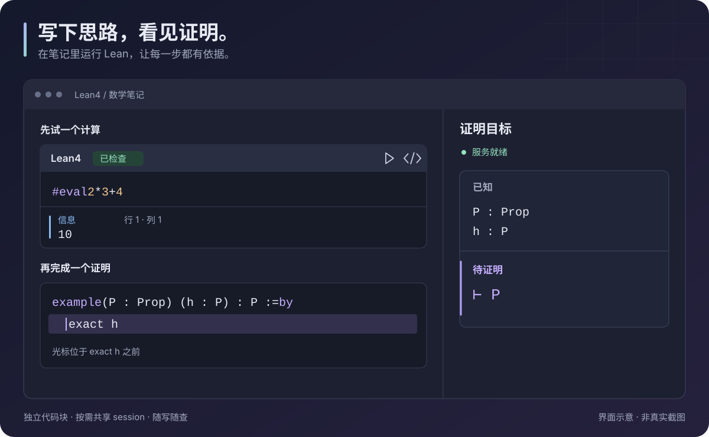

<div align="center">
  
  <h1>Lean4</h1>
  <p><strong>写笔记，试代码，看清证明还差哪一步。</strong></p>
  <p>在 Obsidian 中检查 Lean 4 代码、查看证明目标。</p>
  <p><a href="README.md">English</a> · 简体中文</p>

[](https://github.com/ewigmidori/obsidian-lean4/actions/workflows/ci.yml)
[](LICENSE)
</div>



*这是界面示意图，并非真实截图。实际颜色和布局随 Obsidian 主题变化。*

Lean4 适合数学笔记、简短实验，以及边解释边写的证明。**默认每个代码块独立**；需要把一段证明拆成多个块时，再用同名 session 连接。

直接在普通笔记里开始，无需专门新建 Lean 项目。界面支持简体中文和英文，自动跟随 Obsidian 的语言设置。

## 1. 安装插件

需要 **Obsidian 桌面版 1.8.0 或更新版本**。插件目前尚未上架社区插件目录。

有正式版本后，从 [Releases](https://github.com/ewigmidori/obsidian-lean4/releases) 下载 `main.js`、`manifest.json` 和 `styles.css`。草稿发布只有仓库协作者可见；如果还没有公开版本，请先[从源码构建](#从源码构建)。

1. 在 Vault 中创建 `.obsidian/plugins/lean4-blocks/` 文件夹。
2. 将三个文件放入其中：

   ```text
   <你的 Vault>/.obsidian/plugins/lean4-blocks/
     main.js
     manifest.json
     styles.css
   ```

3. 重启 Obsidian，在 **设置 → 第三方插件** 中启用 **Lean4**。如果仍处于受限模式，先允许使用第三方插件。

## 2. 运行第一个代码块

新建一篇笔记，粘贴以下 Markdown：

````markdown
```lean
#eval 2 * 3 + 4
```
````

将光标放进代码块，在命令面板运行 **Lean4：检查当前代码块**。实时预览或阅读模式中，也可以点击块上的 **▶** 检查图标。

如果提示需要安装 Lean，点击弹出面板中的 **准备 Lean**。保留默认的 **基础环境（自动管理）** 即可：插件优先复用兼容的本地工具链，只有你主动准备时才下载缺少的工具。

检查结束后，消息正文会显示 **`10`**。“信息”表示消息类型，“行 1 · 列 1”表示它在代码块内的位置。这是正常输出，不是错误。

基础环境包含 **Lean 4.35.0 和 Std**，运行这些例子不需要填写项目路径。

## 3. 看清证明还差什么

再添加一个代码块：

````markdown
```lean
example (P : Prop) (h : P) : P := by
  exact h
```
````

在命令面板运行 **Lean4：显示证明目标**，或点击左侧的 **σ** 图标。在编辑模式中，把光标放到 **`exact h` 的开头**，查看执行这条 tactic 之前的状态。

侧栏会显示：

```text
已知
P : Prop
h : P

待证明
⊢ P
```

`h : P` 表示已经有了 `P` 的证明，`⊢ P` 表示当前还需要证明 `P`。`exact h` 就是把已有的证明交给 Lean。将光标移到 tactic 末尾，查看执行后的状态，此时应当没有剩余目标。

目标会随光标位置变化。遇到错误时，点击侧栏消息的行列位置即可回到源码。Lean 返回的目标和报错内容保持原文。

## 4. 默认独立，需要时再共享

两个普通代码块可以都定义 `answer`，不会重名冲突。默认情况下，一个块中的定义**不会被另一个块看见**，所以不同主题的示例可以放心写在同一篇笔记里。

要让几段代码构成连贯的说明，为它们加上相同的 `session`：

````markdown
```lean session=arithmetic title="一个定义"
def base : Nat := 40
```

这里可以用普通 Markdown 解释思路。

```lean session=arithmetic title="一个证明"
example : base + 2 = 42 := by
  rfl
```
````

现在第二块可以使用 `base`。检查任意一块都会检查整个 session，无需按顺序点击。

- 只有**同一篇笔记**中的同名 session 才共享，名称精确匹配、区分大小写。
- 代码按笔记中的当前顺序组合；修改或移动前面的块会改变后面的上下文。
- `import` 放在第一个参与块的顶部。
- 前面的错误可能影响后面的证明，不同 session 仍彼此独立。

## 5. 留下尚未完成的语法示例

只想展示代码时，添加 `check=off`：

````markdown
```lean check=off title="证明草稿"
example (P Q : Prop) : P → Q := by
  -- 在这里解释 tactic 的语法。
```
````

这个块会标为“仅展示”。它不会被检查，即使带有 session 名称，也不会向共享上下文提供代码。

| 属性 | 什么时候用 |
| --- | --- |
| `title="我的示例"` | 给代码块加一个易读的标题。 |
| `session=arithmetic` | 与本篇笔记中同名的块共享定义。 |
| `check=off` | 保留未完成的草稿或故意写错的示例。 |

`lean` 和 `lean4` 标记都可以使用。属性之间用空格分隔，含空格的值加引号。未知或格式错误的属性会显示提示，并让代码块保持仅展示，直到修正。

## 需要更多功能时

**Mathlib 或自己的库。** 在 **设置 → Lean4 → Lean 环境** 中选择 **已有项目（高级）**，填写已经配置好依赖的 Lake 项目路径。先在项目里运行 `lake build`，再点击“保存并应用”。Lean 版本由项目的 `lean-toolchain` 决定；基础环境不包含 Mathlib。

**更快输入符号。** 在 Lean 块里输入 `\alpha`、`\forall` 或 `\to` 后按 **Tab**，即可插入 `α`、`∀` 或 `→`。

**检查整篇笔记。** 运行 **Lean4：检查当前笔记中的所有代码块**。插件会将独立块和共享 session 排队检查，限制同时运行的数量。更多选项在折叠的“性能”设置中。

### 遇到问题时

| 现象 | 可以怎么做 |
| --- | --- |
| Lean 尚未就绪 | 点击“准备 Lean”；失败时展开“详情”查看原始错误。 |
| 看不到证明目标 | 打开“显示证明目标”，进入编辑模式，将光标放在 tactic 中，而不是围栏行上。完成的证明可能没有剩余目标。 |
| 找不到另一个块里的名字 | 给相关块加上相同的 `session`，或把定义和证明放在同一块。 |
| 项目模式找不到 `lake` | 将“Lake 可执行文件”设为 `lake` / `lake.exe` 的绝对路径，不附加命令行参数。 |
| 服务不再响应 | 运行 **Lean4：重启语言服务器**，再检查一次。 |

### 当前范围

这是早期桌面版本，提供纯文本目标、诊断、基础语法着色和 Unicode 快捷输入。尚未实现自动补全、悬停类型、跳转定义或交互式 Lean widgets；暂不支持列表、引用内部的嵌套围栏。整个插件使用同一个选定的 Lean 环境。

自动化检查在 Windows 和 Linux 上运行，但不能替代 Obsidian 桌面测试。具体实测范围见[验证记录](docs/validation.md)。

## 网络访问与外部工具

Lean4 在本机启动 Lean 和 Lake 进程，检查时将代码交给本地语言服务器，不上传到在线证明服务。插件没有遥测，不要求付费服务或账号。

**可选的工具安装：**主动点击“准备 Lean”后，插件才会下载并安装缺少的外部工具。先检测已安装的 Lean 4.35.0；没有 elan 时，从 leanprover/elan 的官方 GitHub Releases（含 GitHub 资源重定向）下载 elan v4.2.4，核对固定 SHA-256 后安装到用户缓存，再调用 elan 从 Lean 官方分发服务安装 leanprover/lean4:v4.35.0。固定摘要校验针对 elan 安装包；Lean 下载由 elan 管理。仅检测环境不会触发这些下载。

**Vault 外文件访问：**基础项目和私有工具存放在 Windows 的 %LOCALAPPDATA%/lean4-obsidian-plugin、macOS 的 ~/Library/Caches/lean4-obsidian-plugin，或 Linux 的 $XDG_CACHE_HOME/lean4-obsidian-plugin（未设置时使用 ~/.cache/lean4-obsidian-plugin）。复用已有 elan 时，缺少的工具链安装到该管理器的工具链目录。插件不修改持久化 PATH 或默认 Lean 工具链。已有项目模式访问用户指定的 Lake 项目，Lake 可能维护自己的 .lake 元数据。

以上外部工具安装行为将如实交由社区审核；披露本身不代表获得了目录依赖安装政策的例外许可。

## 从源码构建

安装 Node.js **22.12+ 或 24+**，然后运行：

```sh
git clone https://github.com/ewigmidori/obsidian-lean4.git
cd obsidian-lean4
npm ci
npm run check
```

这会检查代码并生成 `main.js`。将它与 `manifest.json`、`styles.css` 一起按前面的步骤安装。开发时可运行 `npm run dev` 自动重新构建；重新加载 Obsidian 插件后，新代码才会生效。

## 参与和深入阅读

- [贡献指南（英文）](CONTRIBUTING.md) · [变更日志（英文）](CHANGELOG.md) · [反馈问题](https://github.com/ewigmidori/obsidian-lean4/issues)
- [详细参考](docs/reference.zh-CN.md)：完整围栏语法、设置、环境存储位置和使用限制。
- [架构说明](docs/architecture.md) · [性能记录](docs/performance.md)

使用 [MIT 许可证](LICENSE)，依赖声明见[第三方声明](THIRD_PARTY_NOTICES.txt)。
